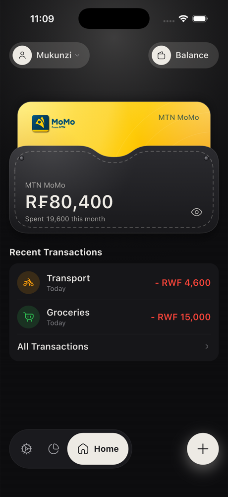
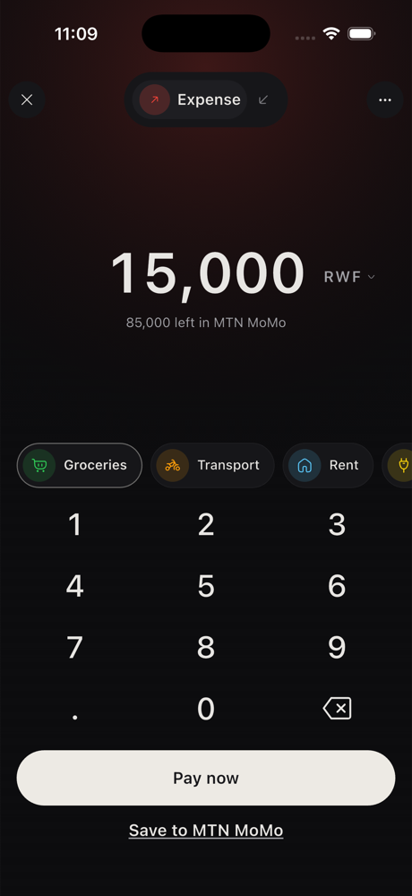
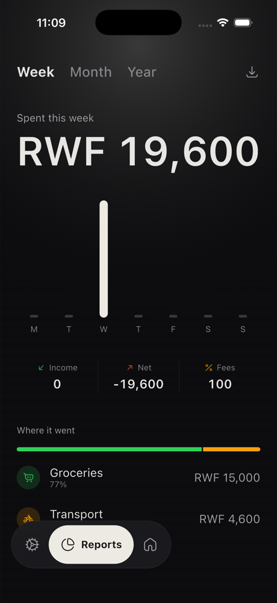
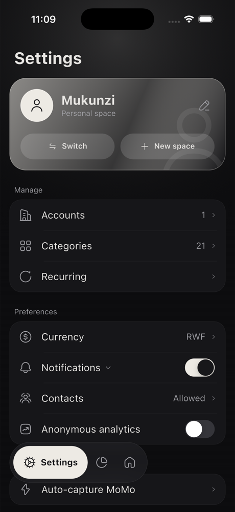
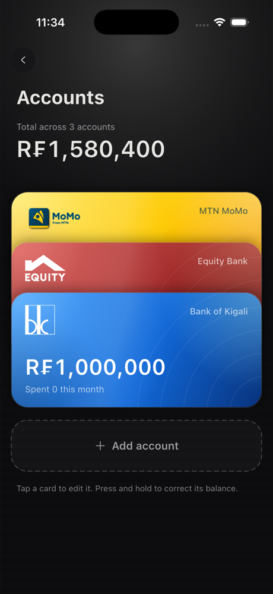
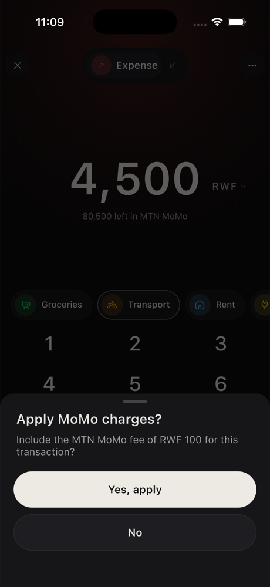
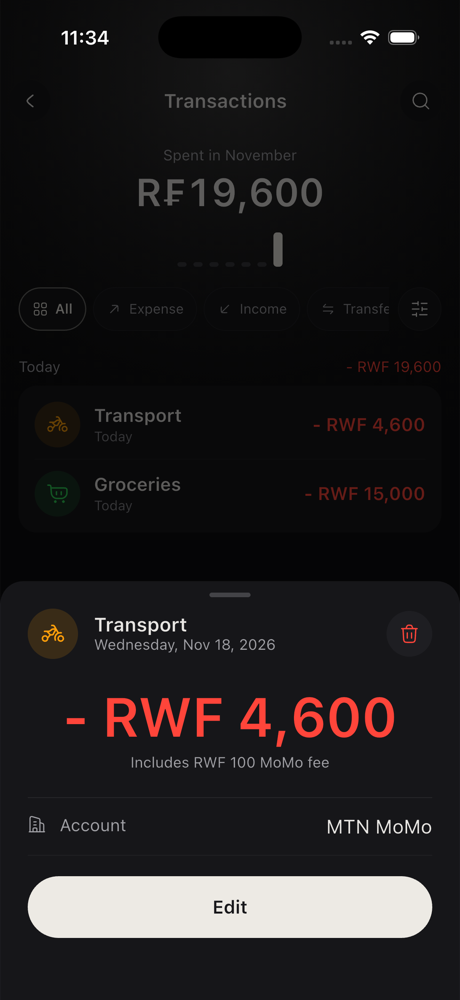
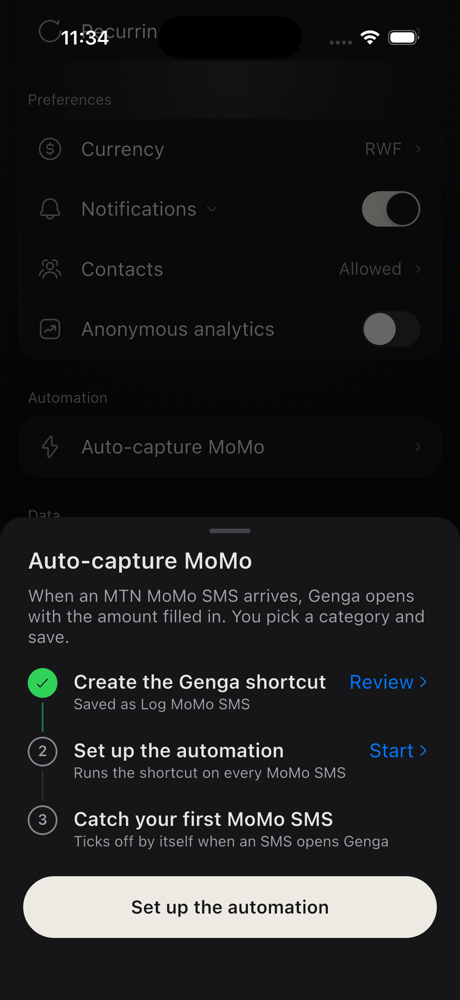
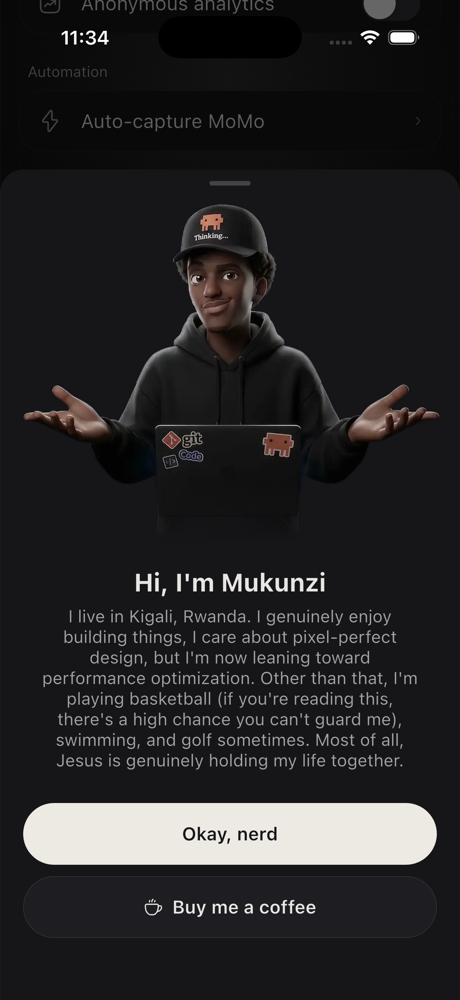

<div align="center">


# Genga

**A calm, private money tracker built for mobile money.**
Log spending in seconds, see where it went, and share a budget with the people you spend with.

</div>

<br />

<p align="center">
  
  
  
  
</p>

## Features

### Your accounts, as a wallet
Every account lives as a card in a wallet on the home screen, branded for MTN MoMo, Airtel Money, Bank of Kigali, Equity, I&M, NCBA and Access. See the balance, what you spent this month, and your latest transactions at a glance. A tap on the eye hides the numbers. The accounts screen stacks every card with your combined total; tap a card to edit it, or press and hold to correct its balance.

<p align="center">
  
</p>

### Log a transaction in a few taps
A calculator-style keypad, category chips and a single button. Choose expense, income or transfer, set the account, add a note, and make it recurring if it repeats. The screen tells you what will be left in the account before you save. Tap any transaction to see its details, edit it or delete it.

### MoMo fees, handled
When you spend from a mobile money account, Genga offers to include the network fee for that amount, so your balance matches what the provider actually took. The fee is shown on the transaction afterwards.

<p align="center">
  
  
</p>

### Reports that answer one question
Week, month and year views show what you spent, your income, net, and fees, with a breakdown of where the money went by category. Export your transactions to CSV in one tap.

### Spaces
A space is a separate set of accounts and transactions: personal, household, a trip. Create as many as you need, switch between them from the home screen, and invite others by link or QR code.

### Auto-capture MoMo
Set up a Shortcut and an automation once. After that, when an MTN MoMo SMS arrives, Genga opens with the amount already filled in. You pick a category and save. The setup sheet walks you through each step and ticks them off as you go.

<p align="center">
  
</p>

### Made for the way you actually pay
- Dial your MoMo or bank balance through USSD straight from the app
- Pay a contact from the pay screen
- Recurring transactions with reminders
- 21 default categories, fully editable
- Home screen widget with balance and recent activity
- Local-first: your data is stored on the device in SQLite

## About the developer

Genga is built by Mukunzi in Kigali, Rwanda. The app has an about sheet in settings, if you want to say hi or buy a coffee.

<p align="center">
  
</p>

## Tech stack

| Area | Choice |
| --- | --- |
| Framework | Flutter, Dart 3 |
| State | Riverpod |
| Navigation | go_router |
| Storage | Drift on SQLite |
| Notifications | flutter_local_notifications |
| Widgets | home_widget |
| Sharing | share_plus, qr_flutter, app_links |

## Project structure

```
lib/
  app/          theme, router, app shell
  core/         database, models, providers, services
  features/     home, transactions, analytics, pay, settings, onboarding
  shared/       widgets, animations, icons, brands
```

## Getting started

Prerequisites: Flutter SDK matching `sdk: ^3.13.2` in `pubspec.yaml`, plus Xcode for iOS or Android Studio for Android.

```bash
git clone git@github.com:Prince-Mukunzi/Genga.git
cd Genga
flutter pub get
dart run build_runner build --delete-conflicting-outputs
flutter run
```

Run the tests:

```bash
flutter test
```

## Status

Genga is under active development. Product analytics and crash reporting are present in the code but switched off until keys are configured.
